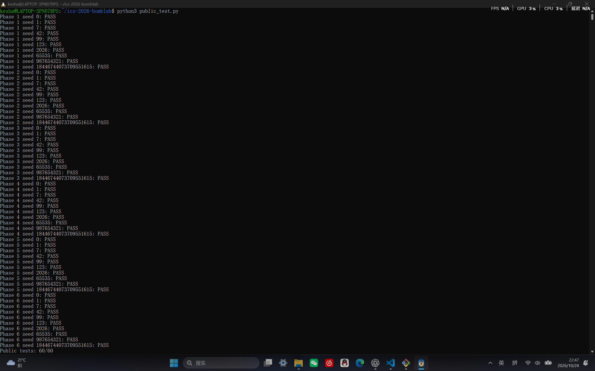
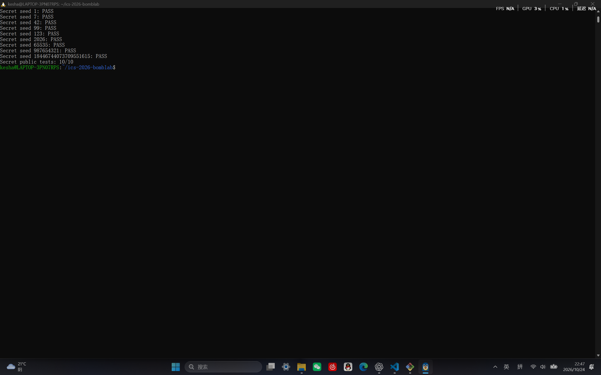
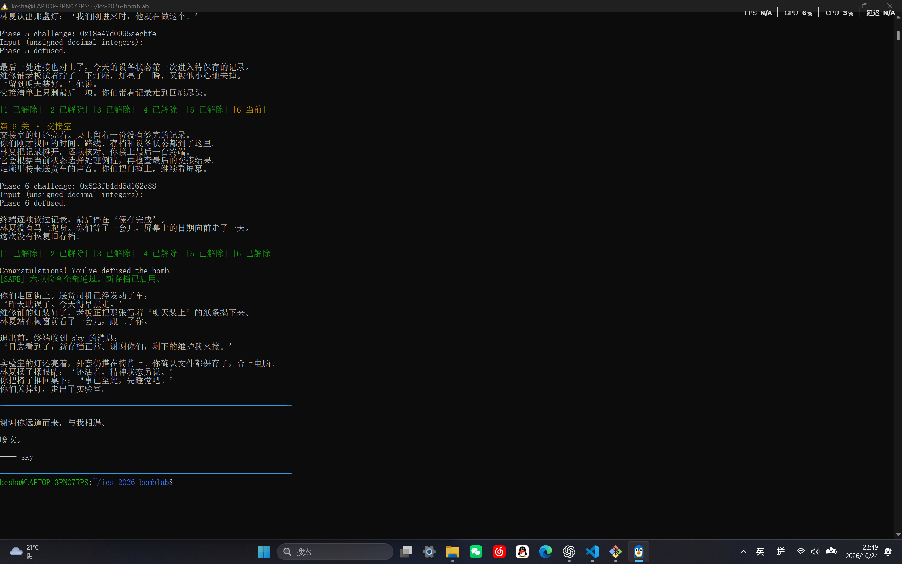
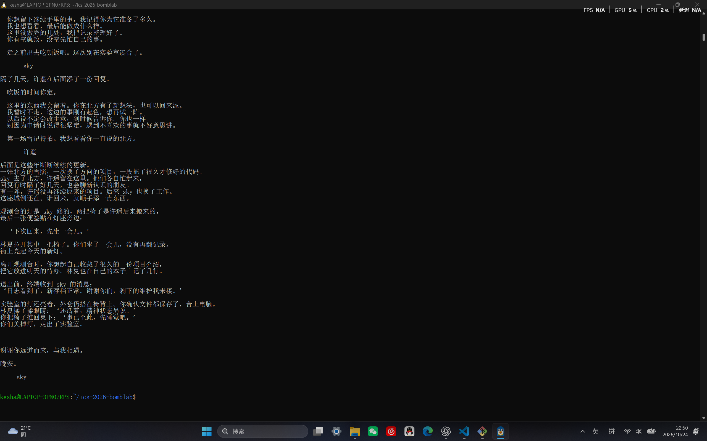

# Lab2: BombLab 实验报告

## 0. 实验环境与验证方式

- 环境：WSL2 Ubuntu，`uname -sm` 输出 `Linux x86_64`
- 领取与编译：`make bomb` 领取个人炸弹，`make` 编译 `defuser`
- 公开测试：`python3 public_test.py`（正式六关 60/60，Honor 10/10）
- 非公开 seed 验证：`./defuser --seed 43 | ./bomb --seed 43`
- 分析方法：`objdump -d --no-show-raw-insn` 离线反汇编 + `gdb -batch` 在线核对寄存器和内存

说明：报告中的地址与立即数均来自我自己的炸弹；不同同学的常量与数据布局可能不同。所有公式都用 `uint32_t` 按模 2³² 的无符号运算实现，与汇编中的 32 位运算宽度一致。

## 1. 第 1 关：函数调用、参数传递、返回值

### 关键汇编

`phase_01` 先调用 `valid_u32_fields` 检查格式，再用 `sscanf` 读一个整数，并与 `p1_compute(challenge)` 的返回值比较：

```
4020d8:  mov    %r12,%rdi
4020db:  call   402050 <p1_compute>
4020e0:  cmp    %eax,-0x14(%rbp)
4020e3:  sete   %al
```

`p1_compute` 把 64 位 challenge 拆成三部分，分别交给 `p1_step0/1/2`：

```
40205d:  shr    $0x20,%rax       ; 高 32 位
402064:  shr    $0x10,%rdx       ; challenge >> 16
402061:  mov    %edi,%r8d        ; 低 32 位
```

### 恢复出的计算关系

设 `low = (uint32_t)challenge`，`high = challenge >> 32`，`mid = (uint32_t)(challenge >> 16)`：

- `p1_step2(high, low) = (3*high + low) ^ 0xd3dc`（注意：调用它时 `esi` 仍是 low32，所以第二个参数其实是 low）
- `p1_step0(low, mid) = 3*(low - mid) + 0x748`
- `p1_step1(a, b) = (5*a) ^ (b + 0x318a)`
- 最终口令 `= p1_step1(p1_step0(...), p1_step2(...)) = (5 * (3*(low-mid) + 0x748)) ^ ((3*high+low) ^ 0xd3dc + 0x318a)`

### 推理过程

先确认第 1 关只需要一个整数；`cmp %eax,-0x14(%rbp)` 表明正确答案就是 `p1_compute` 的返回值。进入 `p1_compute` 后，三个 `p1_step*` 只是简单的移位、`lea`（乘常数加常数）和异或，逐条翻译即可。容易看漏的是 `p1_step2` 除了 `rdi` 还读了 `esi`，而 `esi` 在调用前停在 low32，所以它实际是两个参数。

### 验证

- 公开测试：10/10
- 非公开 seed 43：`./defuser --seed 43 | ./bomb --seed 43` 显示 `Phase 1 defused.`（截图见 `images/seed43.png`）

## 2. 第 2 关：数组、循环、递推关系

### 关键汇编

`phase_02` 用 `sscanf` 读 6 个整数到栈上连续的 6 个局部变量，先检查第 1 个，再用循环检查后 5 个：

```
402167:  lea    (%rax,%rax,2),%eax   ; 乘 3
402178:  mov    %r13,%rax
40217b:  shr    %cl,%rax
40217e:  and    $0x1f,%eax
402181:  add    %edx,%eax            ; 加当前下标
402183:  xor    %esi,%eax            ; 与上一个值异或
402189:  lea    (%rax,%rax,4),%eax   ; 乘 5
402190:  add    $0x1,%rdx
402194:  add    $0x4,%ecx
```

### 恢复出的计算关系

```
v0 = 3 * ((challenge >> 13) & 0x3f)
for i = 1..5:
    shift = 15 + 4*(i-1)
    v[i] = 5 * ( (((challenge >> shift) & 0x1f) + i) ^ v[i-1] )
```

### 推理过程

循环变量 `rdx` 从 1 走到 5，每次 `shr %cl` 的移位量 `ecx` 从 15 开始每次加 4；`add %edx,%eax` 加的是当前下标，`xor %esi,%eax` 里的 `esi` 是上一轮读到的值。第 0 项单独用 `challenge >> 13` 的低 6 位乘 3。

### 验证

- 公开测试：10/10
- 非公开 seed 43：`Phase 2 defused.`（截图见 `images/seed43.png`）

## 3. 第 3 关：switch 分支与跳转表

### 关键汇编

`phase_03` 读 2 个整数，第 1 个必须等于 `challenge & 7`，第 2 个等于 `p3_dispatch` 的返回值：

```
402301:  and    $0x7,%edi
402317:  xor    %eax,%esi
402319:  call   402250 <p3_dispatch>
40231e:  cmp    %eax,-0x14(%rbp)
```

`p3_dispatch` 是跳转表：`jmp *0x405820(,%rax,8)`。跳转表真实内容由 `0x405820` 处 8 个指针决定（不能按 `.text` 中分支的排列顺序去猜）。

### 恢复出的计算关系

设 `idx = (uint32_t)challenge & 7`，`x = (uint32_t)(challenge >> 3) ^ (uint32_t)(challenge >> 32)`，8 个分支为：

```
idx 0: 5*x + 0x3807c
idx 1: (x ^ 0x55a1) + (x >> 1)
idx 2: 3*x + 0x3a1
idx 3: (4*x) ^ 0xeee0
idx 4: (2*x) ^ 0xc8e8
idx 5: 5*x + 0x40191
idx 6: (x ^ 0xdbe8) + (x >> 2)
idx 7: 3*x + 0x1f8f
```

输出为 `idx` 和分支结果两个整数。

### 推理过程

先读 `0x405820` 处的跳转表得到「idx → case」的真实映射（`0→case_0, 1→case_1, 2→case_2, 3→case_7, 4→case_3, 5→case_5, 6→case_4, 7→case_6`），再把 8 个 `case` 函数逐个翻译成公式。`p3_dispatch` 在跳转前把第二个参数移到 `rdi`，所以每个 case 接收的都是 `x`。

### 验证

- 公开测试：10/10
- 非公开 seed 43：`Phase 3 defused.`（截图见 `images/seed43.png`）

## 4. 第 4 关：递归调用与返回过程

### 关键汇编

`phase_04` 读 1 个整数，等于 `p4_walk(a, 0, 0x7f, c)` 的返回值，其中 `a = challenge & 0x7f`，`c = (challenge >> 7) ^ (challenge >> 32)`。

`p4_walk` 是二分查找式递归，每层先算 `mid = b + ((d-b)>>1)`，比较后递归并乘 3、异或：

```
402338:  sub    %esi,%edi
40233a:  shr    $1,%edi
40233c:  add    %esi,%edi       ; mid
402340:  je     402390          ; a == mid
40235c:  lea    (%rax,%rax,2),%eax  ; 乘 3
402366:  xor    $0x7,%eax       ; 右分支再异或 7
402384:  xor    $0x14,%eax      ; 左分支再异或 0x14
```

### 恢复出的计算关系

```
p4_walk(a, b, d, c):
    mid = b + ((d - b) >> 1)
    if a == mid: return (mid + 0xa7) ^ c
    ebx = mid + c
    if a < mid: return (3 * p4_walk(a, b, mid-1, c)) ^ ebx ^ 0x14
    else:       return (3 * p4_walk(a, mid+1, d, c)) ^ ebx ^ 0x7
```

### 推理过程

该函数在 `[b, d]` 区间内二分查找 `a`，每次根据 `a` 与 `mid` 的大小选择左/右区间递归；返回时乘 3 并异或 `(mid+c)`，左、右分支再分别异或 `0x14`、`0x7`。比较是无符号的（`jb`），实现时统一用 `uint32_t`。

### 验证

- 公开测试：10/10
- 非公开 seed 43：`Phase 4 defused.`（截图见 `images/seed43.png`）

## 5. 第 5 关：结构体布局、指针、链表遍历

### 关键汇编

`phase_05` 读 2 个整数，分别等于 `p5_traverse` 的返回值和它写进输出指针的值。

`p5_traverse` 先按 `idx = challenge & 7` 从 `p5_heads` 表取节点，再走 `steps = (challenge >> 3) & 3` 步：

```
402434:  mov    0x405b60(,%rax,8),%rdx   ; 取头节点
402449:  mov    0x8(%rdx),%esi           ; 节点偏移 8
402456:  add    0xc(%rdx),%eax           ; 节点偏移 0xc
402468:  mov    (%rdx),%rdx              ; next 指针
```

### 恢复出的计算关系

节点为 16 字节结构体 `{ next(8字节), f8(偏移8), fc(偏移0xc) }`。设 `a = (challenge>>6)^(challenge>>32)^0xe017`：

```
r = (3*a + node.fc) ^ node.f8
last = node.f8
重复 steps 次: node = node.next; r = (3*r + node.fc) ^ node.f8; last = node.f8
```

我的炸弹中 12 个节点的 `next/f8/fc` 与 8 个头节点的索引已写入 `defuser.c` 的 `p5_next/p5_f8/p5_fc/p5_heads`。

### 推理过程

先用 `gdb x/44wx 0x405ba0` 读出整个节点区，确认每个节点 `[0]` 是 next、`[8]` 是 f8、`[0xc]` 是 fc；再读 `0x405b60` 处的 8 个头指针。`steps ≤ 3`，遍历链最多 4 个节点，按公式逐步更新即可。

### 验证

- 公开测试：10/10
- 非公开 seed 43：`Phase 5 defused.`（截图见 `images/seed43.png`）

## 6. 第 6 关：函数指针表与间接调用

### 关键汇编

`phase_06` 读 1 个整数，等于 `p6_dispatch(challenge)`。`p6_dispatch` 做了两次函数指针间接调用：

```
4025a6:  call   *0x405e00(,%rax,8)   ; 表项 challenge & 7
4025ad:  xor    $0x530f,%eax
4025b4:  call   *0x405e00(%rbx)      ; 表项 (challenge>>3)&7
4025bf:  add    $0x1d60,%eax
```

### 恢复出的计算关系

6 个操作函数（参数 `x` 为 32 位无符号数）：

```
op0: (x ^ 0xc507) + (x << 7)
op1: ror(x, 3)
op2: (8*x + 0x9f24) ^ (7*x)
op3: rol(x, 3) ^ 0x65ca
op4: ((x >> 1) ^ x) + 0xdc94
op5: (x + 0xcef8) ^ (x >> 3)
```

表映射：`0→op3, 1→op1, 2→op2, 3→op4, 4→op4, 5→op5, 6→op0, 7→op1`。

设 `t = (challenge>>6) ^ (challenge>>32)`：

```
r = op[challenge & 7](t) ^ 0x530f
r = op[(challenge>>3) & 7](r) + 0x1d60
```

### 推理过程

`0x405e00` 是一张 8 个函数指针的表；两次调用分别用 challenge 的低 3 位和次低 3 位选函数。`ror`/`rol` 用移位或运算实现（C 没有内建循环移位），其余只是 `lea`、移位、异或的组合。

### 验证

- 公开测试：10/10
- 非公开 seed 43：`Phase 6 defused.`（截图见 `images/seed43.png`）

## 7. Honor（secret phase）

### 触发与入口

`main` 在六关通过后，用 `transcript_context(前六行)` 得到 `context`，用 `phase_challenge(7)` 得到 `challenge`，再调用 `secret_gate`。`secret_gate` 把输入拷到缓冲区后，检查**偏移 32** 处的前 4 字节是否为 `"OPEN"`（`0x4e45504f`），然后把偏移 36 起的文本交给 `secret_phase` 解析。

因此第七行格式为：**32 个任意字节 + `"OPEN"` + 三个整数**。

### 恢复出的计算关系

```
idx = (uint32_t)context & 3
B = (uint32_t)(challenge >> 32) ^ (uint32_t)challenge
C = (uint32_t)(context >> 32) ^ (uint32_t)context
secret_mix(A) = ((A >> 5) ^ 0xe758) + (A ^ 0xd0c7)
T = secret_mix(B ^ C) ^ ((idx * 0xd0c7) ^ (uint32_t)(context >> 16))
v0 = idx
v1 = T
v2 = T ^ (C + idx + 0xe758 + (B >> 5))
```

输出 `32 个空格 + "OPEN v0 v1 v2"`。

### 推理过程

`secret_phase` 读 3 个整数 `v0 v1 v2`，先要求 `v0 == context & 3`，再由 challenge/context 拼出 `B`、`C`，经 `secret_mix` 得到 `T` 作为 `v1`，最后用 `T ^ (C + idx + 0xe758 + (B>>5))` 得到 `v2`。关键是 `secret_gate` 的 `"OPEN"` 检查在偏移 32 处而非行首，所以输出前要补 32 个占位字节。

### 验证

- 公开测试：10/10
- 非公开 seed 43：`Secret phase defused.`（截图见 `images/secret_seed43.png`）

## 8. 运行结果截图








## 9. 参考资料与 AI 工具使用

参考资料：

- 课程实验页面与仓库 README
- 《深入理解计算机系统》
- GDB 官方文档、CS:APP x86-64 GDB 速查表

AI 工具使用说明：使用了 Codex 辅助理解反汇编、翻译关键指令、核对各关恢复出的计算关系，以及排查 `-Werror` 编译报错。所有公式都经本人用 GDB 和多个 seed 验证，代码由本人在理解的基础上写入 `defuser.c`。
